<h1 align="center">Dr. M. Fatih Tüzen 👋</h1>

  <strong>Statistician · R Developer · Time Series & Official Statistics</strong>

  <a href="https://mfatihtuzen.github.io/">Website & Blog</a> ·
  <a href="https://mfatihtuzen.github.io/r-programlama/">R Programming Book</a> ·
  <a href="https://www.linkedin.com/in/dr-m-fatih-t-2b2a4328/">LinkedIn</a> ·
  <a href="https://orcid.org/0000-0003-2779-2151">ORCID</a>

---

### About Me

I'm a statistician and R developer at the **Turkish Statistical Institute (TURKSTAT)**, specializing in **time series analysis, seasonal adjustment, and statistical methodology**.

My work focuses on developing reproducible statistical workflows, automating analytical processes, and building R-based tools for official statistics.

I also contribute to open-source software and educational resources that make statistical methods and data more accessible.

### Selected Projects

- **[tuiksdmx](https://github.com/MFatihTuzen/tuiksdmx)** · [CRAN](https://cran.r-project.org/package=tuiksdmx) · [Documentation](https://mfatihtuzen.github.io/tuiksdmx/)  
  An authenticated, metadata-driven R client for the Turkish Statistical Institute's SDMX REST API.

- **[R Programming Book (in Turkish)](https://mfatihtuzen.github.io/r-programlama/)** · [Source](https://github.com/MFatihTuzen/r-programlama)  
  An open-source Quarto book on R programming and data analysis.

### GitHub Activity

  
  

### Connect

[Website & Blog](https://mfatihtuzen.github.io/) ·
[LinkedIn](https://www.linkedin.com/in/dr-m-fatih-t-2b2a4328/) ·
[ORCID](https://orcid.org/0000-0003-2779-2151) ·
[Email](mailto:mfatihtuzen@gmail.com)
